

<h1>On-premises Active Directory Deployed in Azure</h1>
This tutorial outlines the implementation of on-premises Active Directory within Azure Virtual Machines. 

<h2>Environments and Technologies Used</h2>

- Microsoft Azure (Virtual Machines/Computer)
- Remote Desktop
- Active Directory Domain Services
- PowerShell

<h2>Operating Systems Used </h2>

- Windows Server 2022
- Windows 11

<h2>High-Level Deployment and Configuration Steps</h2>

- Create 2 virtual machines (Domain controller and Client-1)
- Install active directory on Domain controller and join domain from client-1 to domain controller
- Create an Admin and Normal User Account in AD
- Setup Remote Desktop for non-administrative users on Client-1 and Created a bunch of additional users and attempt to log into client-1 with one of the users

<h2>Deployment and Configuration Steps</h2>

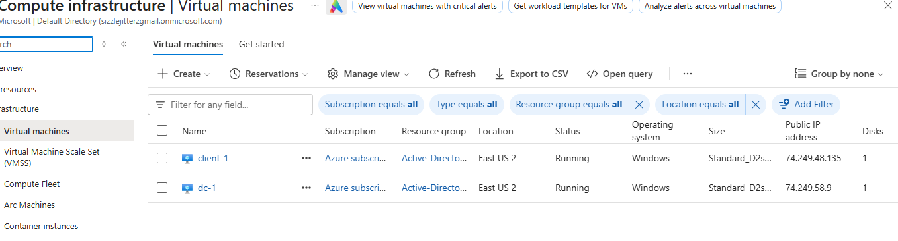
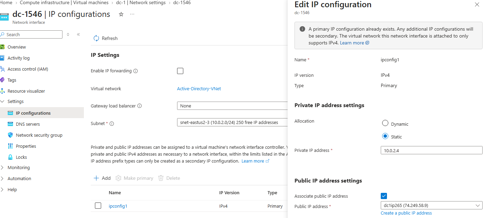
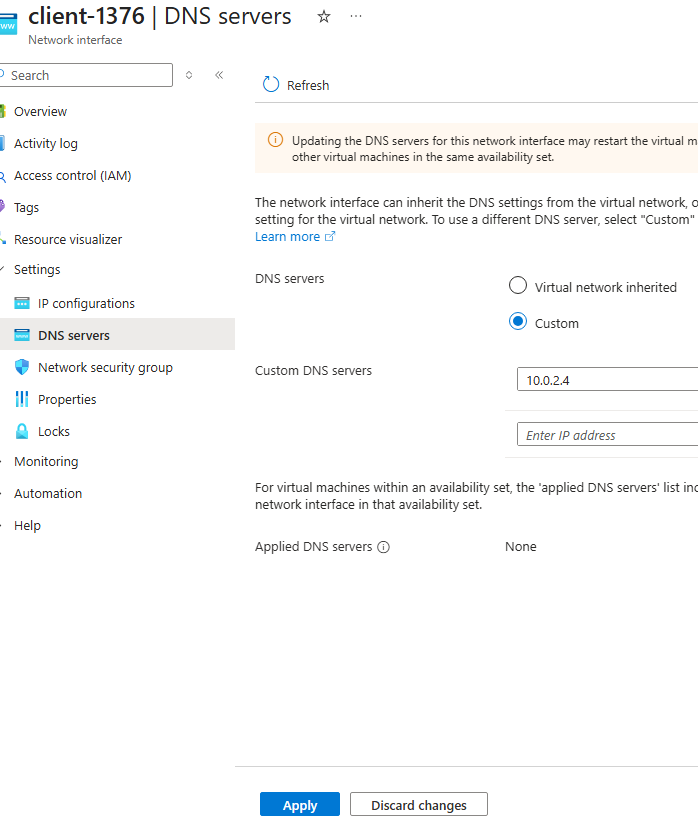

Created the Domain Controller VM (Windows Server 2022) named “DC-1” and created the Client VM (Windows 10) named “Client-1” in Microsoft Azure. I then set the Domain Controller’s NIC Private IP address to be static. I then pointed Client-1 NIC DNS settings to DC-1's Private IP address. This way, Client-1 will look towards DC-1 for all resources.

 

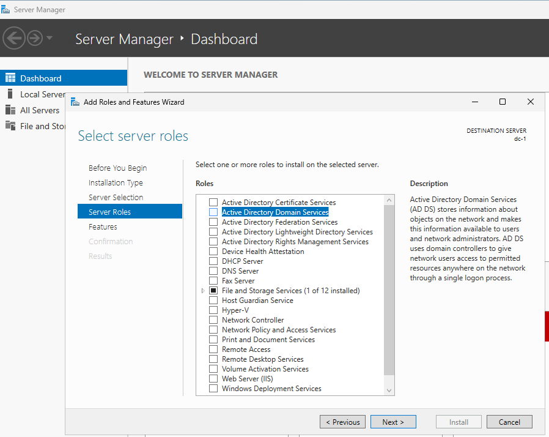
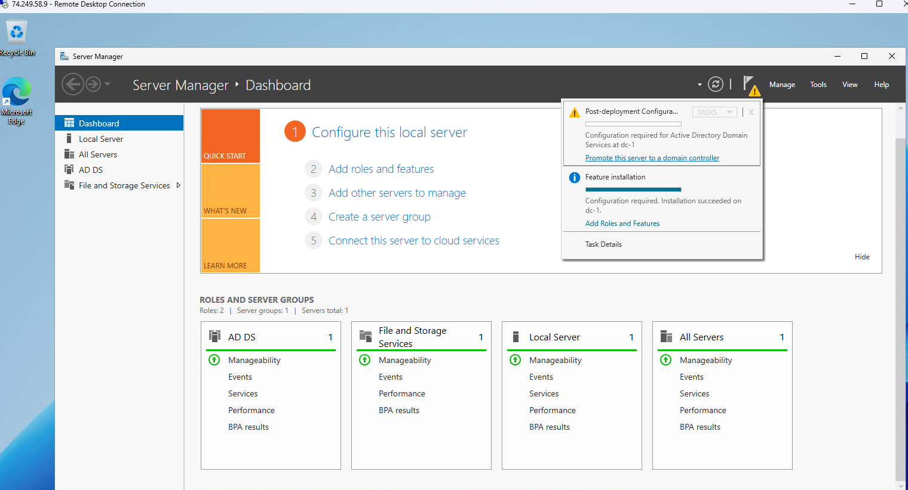
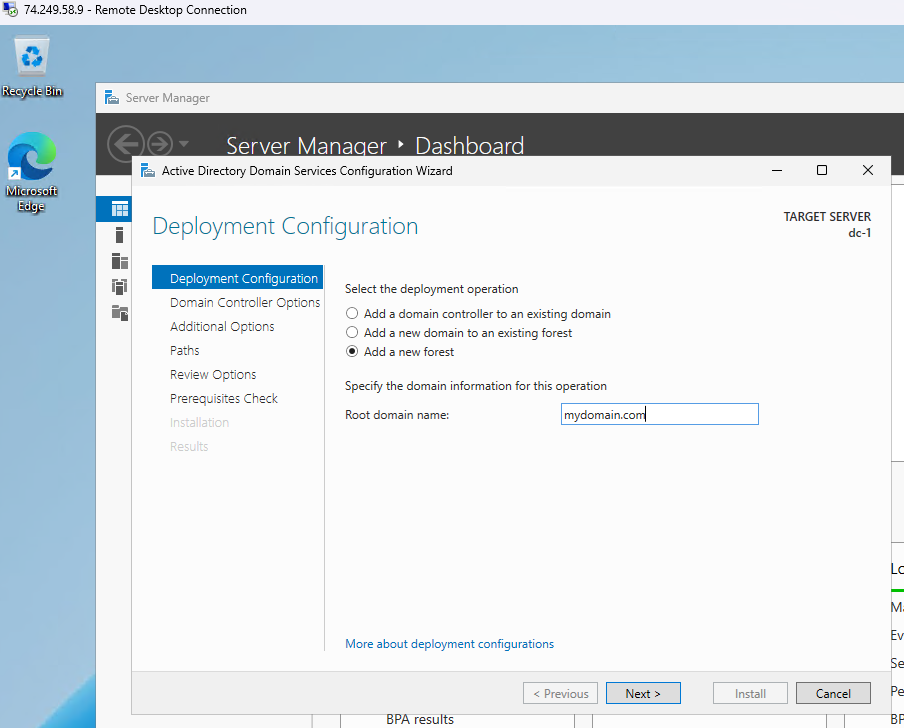

  

Login to DC-1 and install Active Directory Domain Services. Promote as a DC: Setup a new forest as mydomain.com. Restart and then log back into DC-1 as user: mydomain.com\labuser  

 

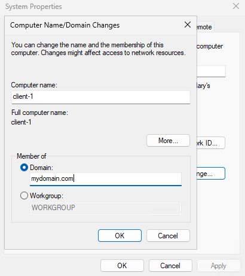
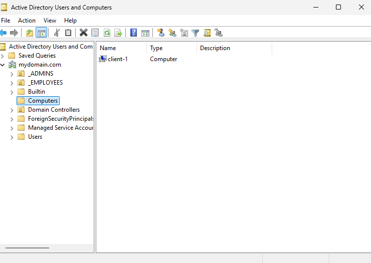

From the Azure Portal, set Client-1’s DNS settings to the DC’s Private IP address. From the Azure Portal, restart Client-1. Login to Client-1 (Remote Desktop) as the original local admin (labuser) and join it to the domain (computer will restart). Login to the Domain Controller (Remote Desktop) and verify Client-1 shows up in Active Directory Users and Computers (ADUC) inside the “Computers” container on the root of the domain. Created a new OU named “_CLIENTS” and drag Client-1 into there. 

 

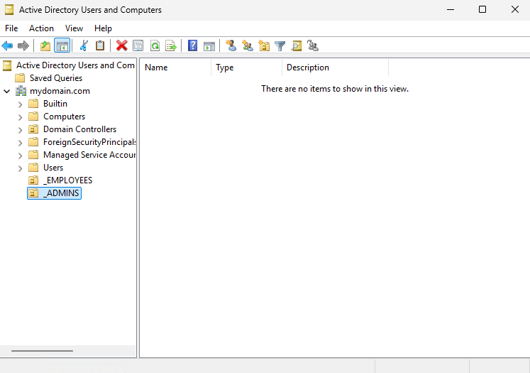
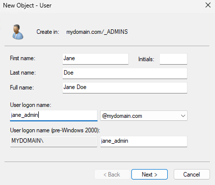
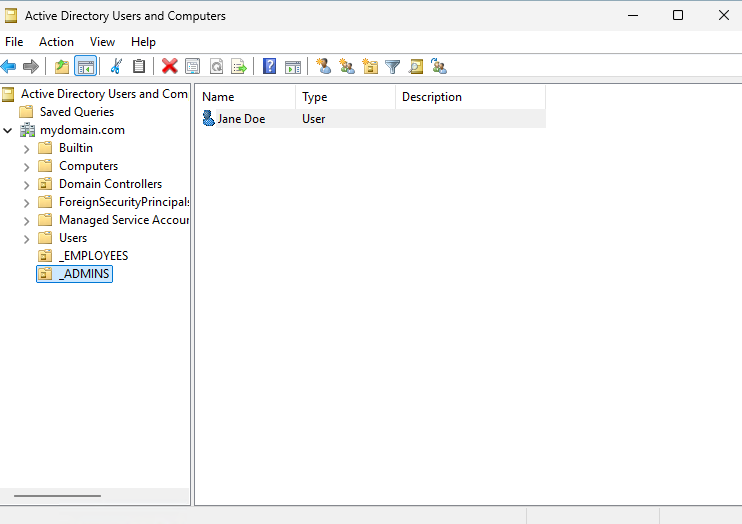

In Active Directory Users and Computers (ADUC), create an Organizational Unit (OU) called “_EMPLOYEES”
Created a new OU named “_ADMINS”. Created a new employee named “Jane Doe” with the username of “jane_admin”
Add jane_admin to the “Domain Admins” Security Group. Logged out of the Remote Desktop connection to DC-1 and logged back in as “mydomain.com\jane_admin”
User jane_admin as my admin account. 

 

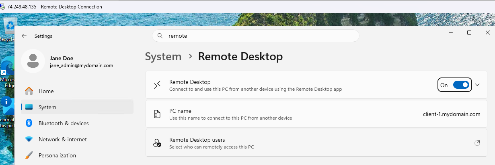
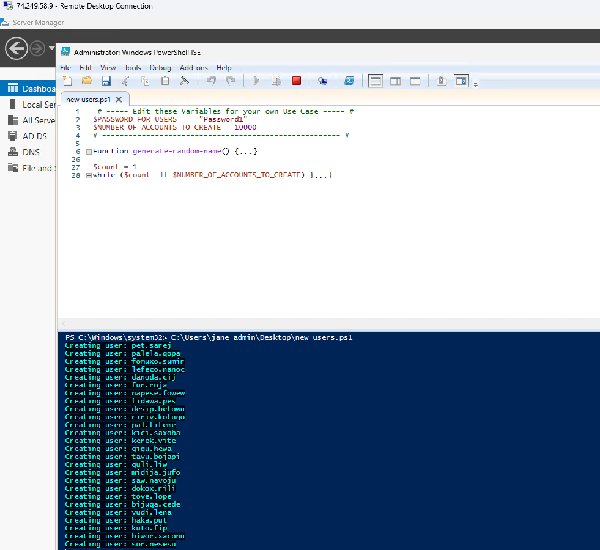

Logged into Client-1 as mydomain.com\jane_admin and open system properties. Clicked “Remote Desktop”. Allowed “domain users” access to remote desktop
Logged in to DC-1 as jane_admin. Opened PowerShell_ise as an administrator. Created a new File and paste the contents of the script into it (https://github.com/joshmadakor1/AD_PS/blob/master/Generate-Names-Create-Users.ps1)
Run the script and observed the accounts being created. When finished, open ADUC and observe the accounts in the appropriate OU
attempted to log into Client-1 with one of the accounts.

 
